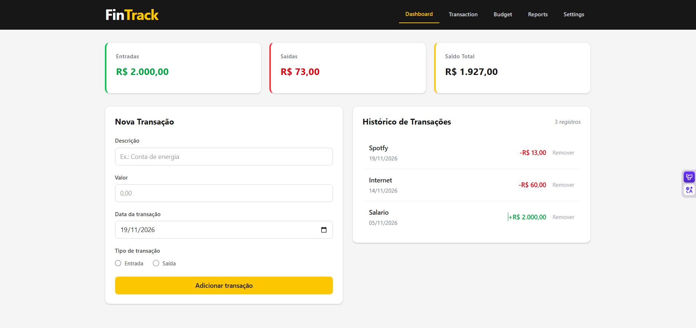

# FinTrack

Aplicação web para controle de finanças pessoais, desenvolvida com React e JavaScript. O FinTrack permite registrar entradas e saídas, acompanhar o saldo total e visualizar o histórico de movimentações financeiras.

## Demonstração



## Funcionalidades

- Cadastro de entradas e saídas.
- Cálculo automático de entradas, saídas e saldo total.
- Histórico de transações.
- Ordenação das movimentações por data.
- Remoção de transações.
- Persistência dos dados no navegador utilizando LocalStorage.
- Interface responsiva.

## Tecnologias utilizadas

- React
- JavaScript
- Tailwind CSS
- Vite
- ESLint
- LocalStorage

## Executando o projeto

**Pré-requisitos:** Node.js e npm instalados.

1. Clone o repositório:

   ```bash
   git clone https://github.com/joaoluis2211/FinTrack.git
   ```

2. Entre na pasta:

   ```bash
   cd FinTrack
   ```

3. Instale as dependências:

   ```bash
   npm install
   ```

4. Inicie o servidor de desenvolvimento:

   ```bash
   npm run dev
   ```

5. Acesse o endereço exibido no terminal.

## Scripts disponíveis

| Comando | Descrição |
|---|---|
| `npm run dev` | Inicia o ambiente de desenvolvimento |
| `npm run build` | Gera a versão de produção |
| `npm run lint` | Executa a análise estática do código |
| `npm run preview` | Visualiza a versão de produção localmente |

## Armazenamento

Os dados das transações são armazenados no LocalStorage do navegador. Portanto, as informações permanecem disponíveis entre sessões no mesmo navegador, sem necessidade de um backend.

## Melhorias futuras

- Edição de transações.
- Filtros por período e tipo.
- Relatórios e gráficos financeiros.
- Integração com backend e banco de dados.

---

Desenvolvido como projeto de estudo para praticar React, JavaScript e desenvolvimento de interfaces web.